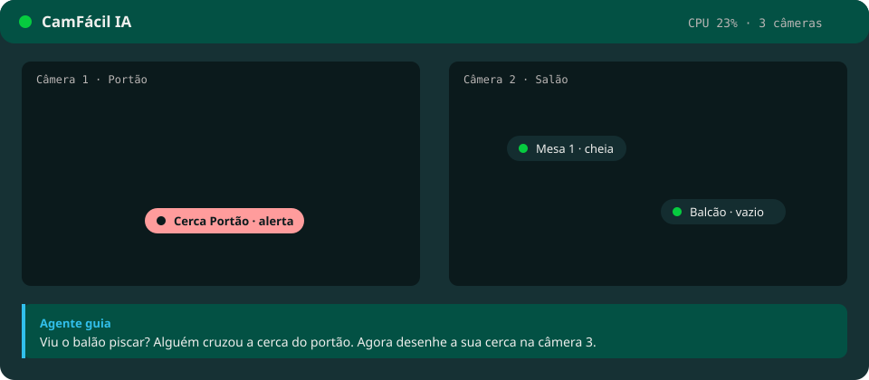
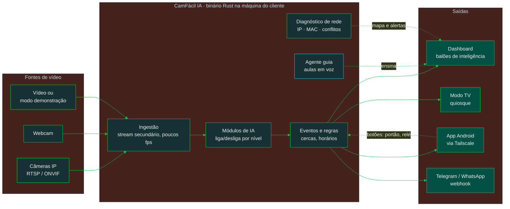
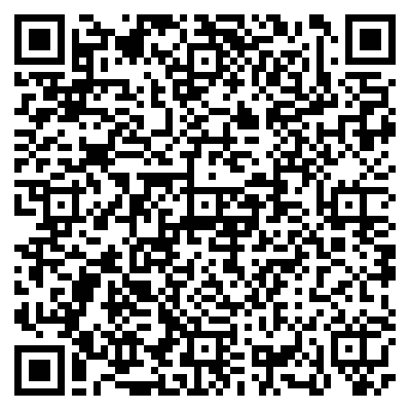

<div align="center">



<a href="https://cfia.ysafe.com.br">
  
</a>

<p>
  
  
  
</p>
<p>
  
  
  
  <a href="https://github.com/emersoncassis/CamFacil-IA/releases/latest/download/camfacil-android.apk"></a>
  
</p>

<a href="https://emersoncassis.github.io/CamFacil-IA/apoiadores/"></a>

<p>
  <a href="https://cfia.ysafe.com.br"></a>
</p>
<p>
  <a href="https://emersoncassis.github.io/CamFacil-IA/"></a>
  <a href="https://emersoncassis.github.io/CamFacil-IA/apoiadores/"></a>
</p>

</div>

---

##  Comece pelo site: **[cfia.ysafe.com.br](https://cfia.ysafe.com.br)**

Tudo começa lá. Abre, ouve as boas-vindas, baixa e pronto.

| | O que o site faz por você |
|---|---|
|  | **Baixa o programa certo** para o seu computador: Windows, Linux ou Raspberry Pi/TV Box. Um clique ou um comando. |
|  | **Ensina do zero**: a [Formação de IA para CFTV](https://cfia.ysafe.com.br/aprender) roda no navegador, com exercícios na prática e narração na voz de quem treinou instaladores no Brasil inteiro. |
|  | **Login com Google**, sem senha nova. Cada técnico vê só os próprios clientes. |
|  | **Pareia o computador do cliente** pelo QR code, pela câmera do celular dentro do site ou digitando o código. |
|  | **Mostra de longe o que o agente está vendo**: câmeras no ar e sem sinal, CPU e memória da máquina, IA ligada e os últimos alertas. Sem vídeo passando pela nuvem. |
|  | **Ensina a ter o seu próprio painel**: o mesmo site, em Docker, na sua VPS. |

**Na entrada você escolhe:**  **Aprender IA do zero**, na [Formação de IA para CFTV](https://cfia.ysafe.com.br/aprender) (roda no navegador, sem baixar nada: seis lições com exercícios em que você desenha a linha e a zona e a IA diz se acertou), ou **Já trabalho com IA**, direto para o download e a operação.

**No programa, depois de baixar:** só operação. Ele abre direto em **Câmeras** e procura sozinho na rede. Você escolhe a câmera, digita a senha e a imagem aparece. Depois, desenhe as regras ou peça “IA, sugira para mim”: alerta com som e tela piscando, saúde da câmera, balões para o cliente. A janela do terminal mostra o resumo ao vivo (CPU, memória, câmeras) e dá para deixar abrindo junto com o computador.

> [!IMPORTANT]
> **O CamFácil IA é um ambiente de aprendizagem e validação.** A solução final no seu cliente é uma câmera ou gravador com **IA de borda**, ou uma plataforma corporativa de IA em nuvem. Aqui você aprende, prova o valor e vende com segurança.

> [!WARNING]
> Uso experimental, de estudo e validação, sem garantias. O projeto não coleta nem hospeda imagens: quem opera é o técnico, responsável pela LGPD junto ao cliente. Leia a [isenção](docs/legal/ISENCAO.md) e os [modelos de LGPD](docs/legal/README.md).

##  Por que existe

Técnico bom trava em duas coisas: **inteligência artificial** e **rede IP**. O CamFácil IA ensina as duas na prática, rodando no computador que já está no balcão do seu cliente. Leia o [manifesto](MANIFESTO.md).

<!-- Substituir pelo GIF real da dashboard quando a fase 2 estiver pronta -->
<div align="center">
  
</div>

##  Como funciona



Tudo roda localmente, sem nuvem obrigatória. A IA só analisa o stream leve da câmera, e o cliente nunca vê caixas ou riscos: só o balão com o nome da regra, que pisca no alerta.

##  Instale em um comando

Tudo também está no site, com passo a passo e narração: **[cfia.ysafe.com.br](https://cfia.ysafe.com.br)**.

 **Windows 10 e 11**: cole no PowerShell (baixa, instala o ffmpeg, cria o atalho e abre)

```powershell
irm https://cfia.ysafe.com.br/instalar.ps1 | iex
```

 **Linux** ·  **Raspberry Pi e TV Box (ARM 64)**

```sh
curl -fsSL https://cfia.ysafe.com.br/instalar.sh | sh
```

 **Android (celular e TV Box)**: baixe o **[app Android (APK)](https://github.com/emersoncassis/CamFacil-IA/releases/latest/download/camfacil-android.apk)**, abra no aparelho e permita instalar de fonte desconhecida quando ele pedir. Ele vira o servidor das câmeras ou vê um cliente à distância.

 **Sem comando:** baixe direto da [última versão](https://github.com/emersoncassis/CamFacil-IA/releases/latest): [Windows](https://github.com/emersoncassis/CamFacil-IA/releases/latest/download/camfacil-windows-x86_64.exe) · [Linux](https://github.com/emersoncassis/CamFacil-IA/releases/latest/download/camfacil-linux-x86_64) · [Raspberry/ARM 64](https://github.com/emersoncassis/CamFacil-IA/releases/latest/download/camfacil-linux-arm64) · [Android (APK)](https://github.com/emersoncassis/CamFacil-IA/releases/latest/download/camfacil-android.apk). Dê dois cliques e o navegador abre. No Windows, se aparecer a tela azul, clique em **Mais informações → Executar assim mesmo** (o programa é gratuito e não tem certificado pago).

**Primeira vez:** o programa abre direto em **Ligar câmera**. Ele procura as câmeras na rede, você escolhe uma, digita usuário e senha e a imagem aparece. A IA vem depois.

> O CamFácil IA escolhe sozinho uma porta livre (começando pela 7070) e nunca usa portas de PDV, ERP, banco de dados ou NVR do cliente. O endereço aparece na tela ao iniciar.

**Rodar a partir do código** (para quem programa):

```sh
git clone https://github.com/emersoncassis/CamFacil-IA && cd CamFacil-IA
cargo run --release -p camfacil
```

##  Painel no seu servidor

O painel web (login com Google, pareamento dos agentes, lista de clientes) é um contêiner Docker. O oficial roda em **[cfia.ysafe.com.br](https://cfia.ysafe.com.br)**, mas você pode subir o seu em **qualquer VPS Linux** (Hostinger, HostGator, Google Cloud, AWS, Oracle, DigitalOcean, Contabo…) ou no seu PC com Docker.

**1. Um comando na VPS** (instala o Docker se faltar, pergunta o domínio, gera a senha do banco e liga HTTPS automático):

```sh
curl -fsSL https://cfia.ysafe.com.br/instalar-painel.sh | sudo sh
```

**2. DNS:** crie um registro **A** do seu domínio (ex.: `painel.suaempresa.com.br`) apontando para o IP da VPS. As portas 80 e 443 precisam estar livres.

**3. Login com Google:** em [console.cloud.google.com](https://console.cloud.google.com) → APIs e serviços → Credenciais → Criar credenciais → **ID do cliente OAuth** → tipo **Aplicativo da Web**. Em *URIs de redirecionamento autorizados* coloque `https://SEU-DOMINIO/api/auth/google/callback`. Copie o ID e a chave secreta para `/opt/camfacil-painel/.env` e rode `cd /opt/camfacil-painel && docker compose up -d`.

**4. Apontar os agentes para o seu painel:** no computador do cliente, abra o programa com a variável `CAMFACIL_SITE=https://SEU-DOMINIO` (Windows: `setx CAMFACIL_SITE https://SEU-DOMINIO` e abra de novo).

<details>
<summary>Testar no seu PC (Docker Desktop) ou instalar à mão</summary>

```sh
mkdir camfacil-painel && cd camfacil-painel
curl -fsSL https://raw.githubusercontent.com/emersoncassis/CamFacil-IA/main/deploy/docker-compose.vps.yml -o docker-compose.yml
printf 'DOMINIO=localhost\nPOSTGRES_PASSWORD=%s\n' "$(openssl rand -hex 20)" > .env
docker compose up -d     # abre em https://localhost
```

Imagem pronta: `ghcr.io/emersoncassis/camfacil-ia-painel:latest`. Para usar com Dokploy, Coolify ou Portainer, aponte para `deploy/docker-compose.dokploy.yml` (detalhes em [docs/DEPLOY.md](docs/DEPLOY.md)). Atualizar: rode o instalador de novo.

</details>

##  Níveis de IA

O CamFácil IA testa a sua máquina e libera só o que ela aguenta.

| Nível | Módulos | Roda em |
|:---:|---|---|
|  **Leve** | Movimento inteligente · Cerca e linha virtual · Saúde das câmeras | Quase qualquer PC |
|  **Médio** | Pessoas e veículos · Contagem · Permanência · Mapa de calor | PC de 4 núcleos, mini PC |
|  **Pesado** | Leitura de placas · Reconhecimento facial | Máquinas mais fortes |

##  As ferramentas

Tudo aberto, livre e gratuito (AGPL-3.0). Cada peça faz uma coisa:

| Ferramenta | Onde roda | O que faz |
|---|---|---|
| **CamFácil IA** (o programa) | PC, mini PC, Raspberry, TV Box | Servidor local: liga as câmeras, roda a IA, manda alertas, dashboard no navegador |
| **Agente-Cam-Elo-IA** (o elo) | Dentro do programa | Pareia com o painel por QR e manda só o resumo (câmeras, máquina, alertas) |
| **Painel de monitoramento** | [cfia.ysafe.com.br](https://cfia.ysafe.com.br) ou o seu servidor | Todos os seus clientes, câmeras no ar, alertas e "ver ao vivo" pelo Tailscale |
| **App Android** | Celular e TV Box | Vira o servidor das câmeras ou vê um cliente à distância |
| **Formação de IA para CFTV** | No navegador | Curso curto com narração, exercícios e selo |
| **Modo estúdio** *(versão básica)* | Navegador + Google Colab | Dois blocos: **Treine sua IA** (descrever, coletar, rotular, treinar no Colab, importar e compartilhar, já funciona) e **VMS sob medida** (aplicação futura, só desenho) |

Leia o [manifesto](https://cfia.ysafe.com.br/manifesto): a IA de vídeo também é do técnico.

##  O que vem na caixa

| | | |
|:---:|---|---|
|  | **Aula em cada clique** | Agente guia com voz explica cada botão, mostra o certo e o erro comum, e propõe um desafio |
|  | **Acha as câmeras sozinho** | Busca ONVIF na rede e gerador de RTSP por fabricante; login salvo (cifrado) para as câmeras que usam o mesmo usuário e senha; editar e remover câmera; reconhece gravador (DVR/NVR) e deixa escolher um ou vários canais |
|  | **Ao vivo** | Mosaico de 1, 2, 3 ou 4 câmeras e, embaixo, o status: aparelho, IA (regras ativas, modelos rodando), alertas, para quem vai cada alerta e serviços ativos |
|  | **Diagnóstico de rede** | Descobre câmera que trocou de IP pelo MAC, conflito de IP e senha padrão |
|  | **Autocorreção de IP** | Opção por câmera: se o DHCP mudar o IP, o programa reconhece a câmera pelo MAC, troca o endereço sozinho, confere a imagem e avisa |
|  | **Diagrama da rede** | Desenha o unifilar da instalação e explica em voz |
|  | **Telegram e WhatsApp** | Alertas e comandos com QR code |
| | ↳ WhatsApp usa uma [Evolution API](https://github.com/EvolutionAPI/evolution-api) que você sobe no mesmo servidor Docker do painel: `docker run -d -p 8080:8080 -e AUTHENTICATION_API_KEY=troque atendai/evolution-api:v2.2.3` e aponte a URL na dashboard (chip dedicado, nunca o seu número) | SDD-04 |
|  | **Modo TV** | Tela de quiosque para o cliente, com a sua logo |
|  | **App Android** | Servidor no próprio celular ou TV Box (com IA de pessoas, YOLO), endereço da rede da loja com QR e botão do Tailscale; ou visualizador à distância, com alertas |
|  | **Relatório de validação** | PDF com a sua marca para fechar a venda |
|  | **MCP e IA** | Configure tudo conversando com uma IA (opcional) |
|  | **Modo estúdio** *(versão básica)* | **Treine sua IA**: descreva uma inteligência nova, rotule no navegador, treine no Colab, rode no programa e compartilhe com outros técnicos (só estudo). **VMS sob medida**: em breve |
|  | **Agente-Cam-Elo-IA** | O elo entre o programa do cliente e o seu painel: pareia por QR e manda só o resumo (o vídeo nunca passa pela nuvem) |

##  Para você, técnico

Você não precisa ser programador. Você precisa de um computador velho, uma câmera (ou só a webcam) e vontade de aprender. Em troca, ganha **um novo serviço para vender**, **conhecimento que nenhum curso entregou na prática** e **liberdade** para escolher a melhor solução para cada cliente.

##  Para quem programa

- Documentação em português, inglês e espanhol, com o manifesto narrado: **[emersoncassis.github.io/CamFacil-IA](https://emersoncassis.github.io/CamFacil-IA/)** (fonte em `site-docs/`, gerado com MkDocs)
- Produto: [`docs/PRD.md`](docs/PRD.md) · Arquitetura: [`docs/sdd/`](docs/sdd) · Decisões: [`docs/adr/`](docs/adr) · Visual: [`DESIGN.md`](DESIGN.md)
- Desenvolvido com [Claude Code](https://claude.com/claude-code): veja [`CLAUDE.md`](CLAUDE.md), os agentes em `.claude/agents/` e as skills em `.claude/skills/`.
- Quer criar um módulo de IA? Comece por [`CONTRIBUTING.md`](CONTRIBUTING.md).

##  Roadmap

Versão atual: **0.8.2** ([releases](https://github.com/emersoncassis/CamFacil-IA/releases)).

- [x] **Fase 1** — Núcleo: binário, dashboard, benchmark, ONVIF, gerador RTSP
- [x] **Fase 2** — Cerca virtual com balões e aula guiada · Formação de IA para CFTV no site, com narração e selo
- [x] **Fase 3** — Telegram (alertas e comandos), WhatsApp via Evolution API, webhook, termos e LGPD, arquivo de alertas
- [x] **Fase 4** — Inventário da rede, câmera que trocou de IP (corrige pelo MAC) e diagrama unifilar em SVG
- [x] **Fase 5** — Modo TV, monitor de hardware, relatório em PDF, backup cifrado e teste de estresse
- [x] **Fase 6** — App Android, web app, Agente-Cam-Elo-IA e MCP
  - [x] Agente-Cam-Elo-IA e painel web (clientes, câmeras, alertas, ver ao vivo pelo Tailscale)
  - [x] App Android: servidor no próprio aparelho ou visualizador à distância
  - [x] MCP (configurar conversando com uma IA, desligado por padrão) · [ADR 0012](docs/adr/0012-mcp-json-rpc-proprio.md)
  - [x] MCP por HTTPS para o Claude (Tailscale Serve/Funnel; ngrok temporário para testes) · [ADR 0015](docs/adr/0015-mcp-https-tailscale-e-ngrok.md)
  - [x] Botões de portão e relé no app, com PIN, confirmação e log
  - [x] Autocorreção de IP da câmera pelo MAC (opção por câmera, com conferência da imagem e antirrepique)
  - [x] Gravador (DVR/NVR): escolher os canais ao ligar, trocar o canal no Editar e corrigir o IP de todos os canais juntos
- [ ] **Fase 7** — Modo estúdio · [versão básica](https://cfia.ysafe.com.br/estudio)
  - [x] Receita de módulo validada (biometria bloqueada), gerador do notebook do Colab, importar modelo de estudo, compartilhar receitas no site
  - [x] Assistente no site, de ponta a ponta e sem rolagem: descrever (receita conferida pelo núcleo), coletar, rotular no navegador (fotos nunca vão ao servidor, exporta .zip YOLO), notebook do Colab, importar e galeria de receitas
  - [x] Programa local: coletar fotos de uma câmera numa pasta e rodar o modelo de estudo ligado à mão (classes da receita no balão da regra)
  - [ ] Conversa com a IA gerando a receita, vocabulário aberto e pré-marcação no navegador

- [ ] **Aplicação futura** — **VMS sob medida** · [desenho no estúdio](https://cfia.ysafe.com.br/estudio#vms) (só desenho, ainda não faz nada)
  - Com um assistente de código (Claude Code, Codex ou outro do mercado) ligado ao CamFácil IA por MCP, o técnico monta o próprio VMS, do jeito dele
  - Base: a IA local do CamFácil IA e a integração nativa com as APIs dos fabricantes (Intelbras, Hikvision, Dahua e outros), para construir algo que funciona e não falha

### Novidades da 0.8.2
- **Nada fica rodando escondido**: ngrok e ffmpeg morrem junto com o programa, mesmo se ele for fechado à força (janela fechada, Gerenciador de Tarefas). No Windows, por Job Object; no Linux/Android, por sinal do sistema. Ao abrir, derruba um ngrok que uma versão anterior tenha deixado.
- **Desinstalar** (Manutenção > Dados): para ngrok, endereço HTTPS do Tailscale e o abrir com o computador, tira o atalho e o programa e, se marcado, apaga os dados.
- **Versão no nome do arquivo baixado**: o site baixa `camfacil-0.8.2-windows-x86_64.exe` (e o mesmo para Linux, ARM e Android).

### Novidades da 0.8.1
- **MCP por HTTPS** (o Claude exige): pelo **Tailscale Serve** (só sua rede Tailscale) ou **Tailscale Funnel** (internet, para os conectores do claude.ai, com confirmação forte e token). Para Claude Desktop e Claude Code na mesma máquina, configuração por stdio pronta para colar (ADR 0015).
- **ngrok temporário** no Acesso de fora e no MCP: o programa baixa o agente oficial e sobe o túnel; aviso obrigatório de que é só para testes, pode cair e não é seguro (para mais de um dia, Tailscale); painel protegido por senha aleatória; opção de desligar sozinho após 24 h.

### Novidades da 0.8.0
- **Ao vivo completo**: balões das regras sobre cada câmera (alinhados à imagem, piscam no alerta), som do alerta (com "Ligar som" e mudo) e escolha de stream **extra** (padrão) ou **principal** por câmera, com aviso de que o principal é da gravação e pesa mais.
- **Nome real do canal** do DVR/NVR (Intelbras/Dahua e Hikvision, via Digest) vira o nome da câmera; nomes genéricos são descartados.
- **Nome padrão sem IP**: "Câmera 1", "Gravador 1"; os nomes antigos com IP são trocados sozinhos.
- **IA, sugira para mim** com textos curtos e confiança só em "% · boa/baixa".
- Botões de portão e relé também com HTTP Digest.

### Novidades da 0.7.1
- **IA, sugira para mim** consertado: botão **Cancelar**; **uma regra por pesquisa** (aceitar pede confirmação, cria a regra e para a pesquisa); o traçado tracejado sai da imagem; confiança **70% ou mais = boa**, abaixo disso aviso para observar de novo.
- **Dados numa pasta só, ao lado do programa** (`camfacil-dados`): nada em pasta escondida nem no registro. Em Manutenção > Dados, **Apagar todos os dados** zera o programa, inclusive a pasta antiga das versões até 0.7.
- **Mostrar linhas e zonas**: interruptor no ao vivo da câmera para mostrar o desenho das regras além do balão (desligado por padrão).

### Novidades da 0.7.0
- **Autocorreção de IP pelo MAC**: chave por câmera (Ligar e Editar), desligada por padrão. Confere porta RTSP e MAC no IP novo, troca só o host, confere a imagem em até 15 s e desfaz se não voltar. Não corrige com conflito de IP; no máximo uma correção a cada 10 min. Avisa no Início, no Ao vivo e no Telegram/WhatsApp/webhook. Histórico na tela Rede e no backup.
- **Gravador (DVR/NVR)**: reconhece o gravador (ONVIF, modelo ou teste dos canais) e deixa escolher um ou vários canais; cada canal vira uma câmera "Gravador · Canal N", no substream por padrão. Troca de canal no Editar; se o gravador mudar de IP, todos os canais corrigem juntos.
- **Estúdio**: abre com dois blocos fechados, *Treine sua IA* (os seis passos, funcionando) e *VMS sob medida* (só desenho).
- **Celular estreito**: ações do cabeçalho das telas viram só ícone, para não passar da borda.
- Ainda falta validar autocorreção e DVR/NVR com equipamento real (testados com rede simulada e gravador falso de 4 canais).

### Novidades da 0.5 e 0.6
- **Ao vivo**: mosaico de 1 a 4 câmeras e, embaixo, aparelho, IA, alertas, para quem vai e serviços ativos.
- **Login salvo das câmeras**, editar e remover câmera, zero rolagem em todas as telas.
- **Android**: IA de pessoas (YOLO) no aparelho, tela do servidor com o endereço da rede da loja e QR, botão do Tailscale.
- **Estúdio básico** de ponta a ponta e **manifesto narrado** no site.

### Regra de tela
Nenhuma tela rola: programa, app, site e curso cabem numa tela só, do celular ao monitor. O que não cabe vira aba, seção que abre ou página (regra 9 do [`CLAUDE.md`](CLAUDE.md), detalhes no [`DESIGN.md`](DESIGN.md)).

### Em desenvolvimento / próximos passos
- Modo estúdio: conversa com a IA montando a receita, pré-marcação das fotos (vocabulário aberto) e posição da linha/zona vinda da receita (fase 7)
- Mosaico ao vivo com mais de 4 câmeras (6, 9, 16)
- Rede: senha de fábrica, quedas por hora e banda por câmera (conflito de IP já avisa na tela Rede)
- Telegram: backup agendado; foto do alerta com a linha/zona desenhada (`/backup <senha>` já existe)
- Android: câmera do próprio celular como fonte, chave de assinatura fixa do APK, APK por arquitetura (hoje ~20 MB com a IA)
- Testes em campo: rede real, Windows, TV Box com controle remoto, autocorreção de IP e canais de DVR/NVR com equipamento de verdade

##  Apoie o projeto

O CamFácil IA é livre e gratuito, e vai continuar assim. Por trás dele tem tempo, estudo, anos de sala de aula e dinheiro do próprio bolso: só para começar, foram mais de R$ 10 mil.

Se ele te ajudou a aprender, a vender ou a ganhar tempo, **pague um café**. Cada apoio mantém o projeto vivo e aberto para o próximo técnico.

<table>
  <tr>
    <td></td>
    <td>
      <b>Pix (CPF)</b><br/>
      <code></code><br/>
      Emerson de Carvalho Assis<br/><br/>
      Fora do Brasil: <a href="https://buymeacoffee.com/emersoncarvalho">Buy Me a Coffee</a>
    </td>
  </tr>
</table>

| Apoio | O que você recebe |
|---|---|
| **Doação livre** · qualquer valor | Seu nome e recado no mural |
| **Até R$ 500** · pedido de funcionalidade | Sua sugestão é lida e avaliada por mim |
| **A partir de R$ 1.000** · conversa | Uma hora de conversa comigo pelo Google Meet |
| **A partir de R$ 5.000** · desenvolvimento | Desenvolvemos juntos uma aplicação para você, com base no CamFácil IA |

Os **10 primeiros** apoiadores viram **Apoiadores Fundadores**, com selo para sempre no mural. Já estão lá **Marcone (Mar Câmeras)**, que criou o [Contagem Inteligente](https://contagem.marcameras.com.br/), e o **Alexandre (Papo Segurança)**.

Ideias e pedidos de funcionalidade passam pelo apoio. Prefere fazer você mesmo? O código é aberto: abra um pull request, que eu avalio quando possível.

Depois do Pix, **[entre no mural de apoiadores](https://emersoncassis.github.io/CamFacil-IA/apoiadores/)**: mande o comprovante, um recado e o que você gostaria que fosse desenvolvido.

##  Contribua

<a href="https://github.com/emersoncassis/CamFacil-IA/graphs/contributors">
  
</a>

<div align="center">

<sub>Identidade visual inspirada na paleta da Intelbras, onde este projeto nasceu. Projeto independente, sem vínculo com a Intelbras.</sub>


</div>
