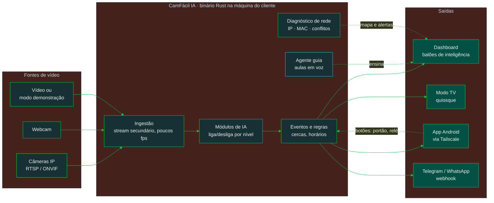

<div align="center">


<a href="#-instale-em-um-comando">
  
</a>

<p>
  
  
  
</p>
<p>
  
  
  
  
  
</p>

</div>

---

> [!IMPORTANT]
> **O CamFácil IA é um ambiente de aprendizagem e validação.** A solução final no seu cliente é uma câmera ou gravador com **IA de borda**, ou uma plataforma corporativa de IA em nuvem. Aqui você aprende, prova o valor e vende com segurança.

> [!WARNING]
> Uso experimental, de estudo e validação, sem garantias. O projeto não coleta nem hospeda imagens: quem opera é o técnico, responsável pela LGPD junto ao cliente. Leia a [isenção](docs/legal/ISENCAO.md) e os [modelos de LGPD](docs/legal/README.md).

##  Por que existe

Técnico bom trava em duas coisas: **inteligência artificial** e **rede IP**. O CamFácil IA ensina as duas na prática, rodando no computador que já está no balcão do seu cliente. Leia o [manifesto](MANIFESTO.md).

<!-- Substituir pelo GIF real da dashboard quando a fase 2 estiver pronta -->
<div align="center">
  
</div>

##  Como funciona



Tudo roda localmente, sem nuvem obrigatória. A IA só analisa o stream leve da câmera, e o cliente nunca vê caixas ou riscos: só o balão com o nome da regra, que pisca no alerta.

##  Instale em um comando

```sh
# Linux / Raspberry Pi (em breve)
curl -fsSL https://raw.githubusercontent.com/emersoncassis/CamFacil-IA/main/install.sh | sh
```

```powershell
# Windows (em breve)
irm https://raw.githubusercontent.com/emersoncassis/CamFacil-IA/main/install.ps1 | iex
```

Ou baixe o `camfacil.exe` em **[Releases](https://github.com/emersoncassis/CamFacil-IA/releases)**, dê dois cliques e abra `http://localhost:7070`.

##  Níveis de IA

O CamFácil IA testa a sua máquina e libera só o que ela aguenta.

| Nível | Módulos | Roda em |
|:---:|---|---|
|  **Leve** | Movimento inteligente · Cerca e linha virtual · Saúde das câmeras | Quase qualquer PC |
|  **Médio** | Pessoas e veículos · Contagem · Permanência · Mapa de calor | PC de 4 núcleos, mini PC |
|  **Pesado** | Leitura de placas · Reconhecimento facial | Máquinas mais fortes |

##  O que vem na caixa

| | | |
|:---:|---|---|
|  | **Aula em cada clique** | Agente guia com voz explica cada botão, mostra o certo e o erro comum, e propõe um desafio |
|  | **Acha as câmeras sozinho** | Busca ONVIF na rede e gerador de RTSP por fabricante |
|  | **Diagnóstico de rede** | Descobre câmera que trocou de IP pelo MAC, conflito de IP e senha padrão |
|  | **Diagrama da rede** | Desenha o unifilar da instalação e explica em voz |
|  | **Telegram e WhatsApp** | Alertas e comandos com QR code |
|  | **Modo TV** | Tela de quiosque para o cliente, com a sua logo |
|  | **App Android** | Ao vivo, alertas e botões para portão e relé, via Tailscale |
|  | **Relatório de validação** | PDF com a sua marca para fechar a venda |
|  | **MCP e IA** | Configure tudo conversando com uma IA (opcional) |
|  | **Modo estúdio** | Descreva uma inteligência nova e aprenda como ela é montada (só estudo) |
|  | **Agente-Cam-Elo-IA** | Ponte leve entre o navegador e as câmeras da rede local |

##  Para você, técnico

Você não precisa ser programador. Você precisa de um computador velho, uma câmera (ou só a webcam) e vontade de aprender. Em troca, ganha **um novo serviço para vender**, **conhecimento que nenhum curso entregou na prática** e **liberdade** para escolher a melhor solução para cada cliente.

##  Para quem programa

- Produto: [`docs/PRD.md`](docs/PRD.md) · Arquitetura: [`docs/sdd/`](docs/sdd) · Decisões: [`docs/adr/`](docs/adr) · Visual: [`docs/DESIGN_SYSTEM.md`](docs/DESIGN_SYSTEM.md)
- Desenvolvido com [Claude Code](https://claude.com/claude-code): veja [`CLAUDE.md`](CLAUDE.md), os agentes em `.claude/agents/` e as skills em `.claude/skills/`.
- Quer criar um módulo de IA? Comece por [`CONTRIBUTING.md`](CONTRIBUTING.md).

##  Roadmap

- [ ] **Fase 1** — Núcleo: binário, dashboard, benchmark, ONVIF, gerador RTSP
- [ ] **Fase 2** — Cerca virtual com balões e aula guiada
- [ ] **Fase 3** — Telegram, WhatsApp e comandos
- [ ] **Fase 4** — Diagnóstico de rede e diagrama unifilar
- [ ] **Fase 5** — Modo TV, monitor de hardware, relatório e backup
- [ ] **Fase 6** — App Android, web app, Agente-Cam-Elo-IA e MCP
- [ ] **Fase 7** — Modo estúdio

##  Contribua

<a href="https://github.com/emersoncassis/CamFacil-IA/graphs/contributors">
  
</a>

<div align="center">

<sub>Identidade visual inspirada na paleta da Intelbras, onde este projeto nasceu. Projeto independente, sem vínculo com a Intelbras.</sub>


</div>
