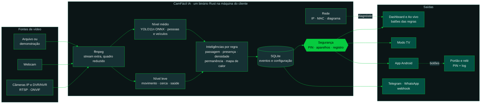
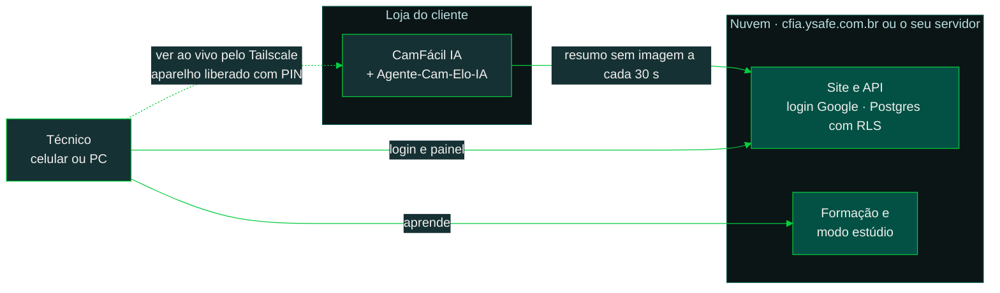
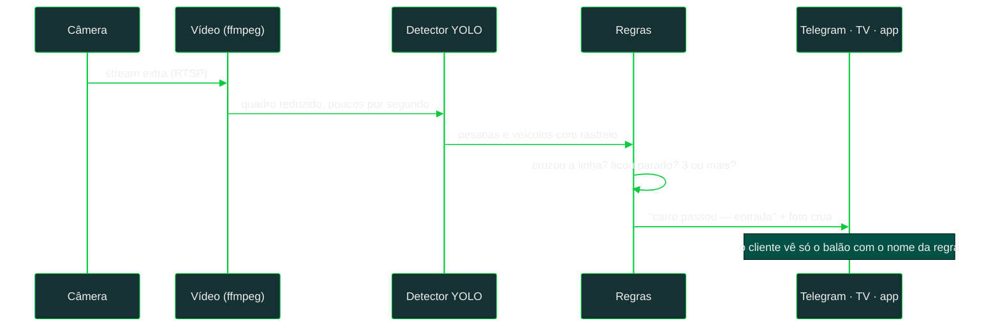
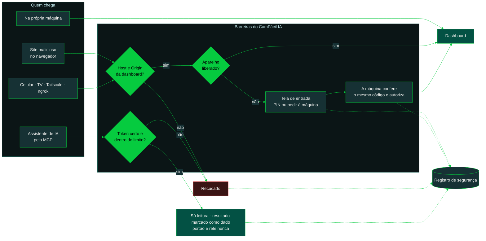

<div align="center">


<a href="https://cfia.ysafe.com.br">
  
</a>

<p>
  
  
  
</p>
<p>
  
  
  
  <a href="https://github.com/emersoncassis/CamFacil-IA/releases/latest/download/camfacil-android.apk"></a>
  
</p>

<a href="https://emersoncassis.github.io/CamFacil-IA/apoiadores/"></a>

<p>
  <a href="https://cfia.ysafe.com.br"></a>
  <a href="https://emersoncassis.github.io/CamFacil-IA/mapa-do-codigo/"></a>
</p>

<a href="https://emersoncassis.github.io/CamFacil-IA/mapa-do-codigo/"></a>
<p>
  <a href="https://emersoncassis.github.io/CamFacil-IA/"></a>
  <a href="https://cfia.ysafe.com.br/#apoiar"></a>
</p>

</div>

---

##  CamFácil IA Builder: monte a sua versão

<a href="https://emersoncassis.github.io/CamFacil-IA/builder/"></a>

O **Builder** é o mestre de obras deste projeto: todo desenvolvimento, seu ou da comunidade, começa por ele. É uma skill para assistentes de código (Claude Code, Codex e outros) que conversa com quem **nunca programou**. Você diz o que quer, ele muda telas, cria funções e inteligências, e explica cada passo.

1. Faça o **[fork](https://github.com/emersoncassis/CamFacil-IA/fork)** e clone a sua cópia.
2. Abra a pasta no seu assistente de código.
3. Chame `/camfacil-ia-builder` e diga o que você quer.

Ele trabalha com o método do **[Reversa](https://github.com/sandeco/reversa)**, do professor Sandeco Macedo (primeiro o combinado, depois o código), e respeita a LGPD, a licença AGPL-3.0, a segurança e as regras do projeto. Pedido que fere uma delas é recusado, com o motivo e uma alternativa.

**[Conheça o Builder](https://emersoncassis.github.io/CamFacil-IA/builder/)** · [a skill](.claude/skills/camfacil-ia-builder/SKILL.md) · [o que ele não faz e por quê](.claude/skills/camfacil-ia-builder/referencias/limites.md)

<br clear="right"/>

##  Comece pelo site: **[cfia.ysafe.com.br](https://cfia.ysafe.com.br)**

Tudo começa lá. Abre, ouve as boas-vindas, baixa e pronto.

| | O que o site faz por você |
|---|---|
|  | **Baixa o programa certo** para o seu computador: Windows, Linux ou Raspberry Pi/TV Box. Um clique ou um comando. |
|  | **Ensina do zero**: a [Formação de IA para CFTV](https://cfia.ysafe.com.br/aprender) roda no navegador, com exercícios na prática e narração na voz de quem treinou instaladores no Brasil inteiro. |
|  | **Login com Google**, sem senha nova. Cada técnico vê só os próprios clientes. |
|  | **Pareia o computador do cliente** pelo QR code, pela câmera do celular dentro do site ou digitando o código. |
|  | **Mostra de longe o que o agente está vendo**: câmeras no ar e sem sinal, CPU e memória da máquina, IA ligada e os últimos alertas. Sem vídeo passando pela nuvem. |
|  | **Ensina a ter o seu próprio painel**: o mesmo site, em Docker, na sua VPS. |

**Na entrada você escolhe:**  **Aprender IA do zero**, na [Formação de IA para CFTV](https://cfia.ysafe.com.br/aprender) (roda no navegador, sem baixar nada: seis lições com exercícios em que você desenha a linha e a zona e a IA diz se acertou), ou **Já trabalho com IA**, direto para o download e a operação.

**No programa, depois de baixar:** só operação. Ele abre direto em **Câmeras** e procura sozinho na rede. Você escolhe a câmera, digita a senha e a imagem aparece. Depois, desenhe as regras ou peça “IA, sugira para mim”: alerta com som e tela piscando, saúde da câmera, balões para o cliente. A janela do terminal mostra o resumo ao vivo (CPU, memória, câmeras) e dá para deixar abrindo junto com o computador.

> [!IMPORTANT]
> **O CamFácil IA é um ambiente de aprendizagem e validação.** A solução final no seu cliente é uma câmera ou gravador com **IA de borda**, ou uma plataforma corporativa de IA em nuvem. Aqui você aprende, prova o valor e vende com segurança.

> [!WARNING]
> Uso experimental, de estudo e validação, sem garantias. O projeto não coleta nem hospeda imagens: quem opera é o técnico, responsável pela LGPD junto ao cliente. Leia a [isenção](docs/legal/ISENCAO.md) e os [modelos de LGPD](docs/legal/README.md).

##  Por que existe

Técnico bom trava em duas coisas: **inteligência artificial** e **rede IP**. O CamFácil IA ensina as duas na prática, rodando no computador que já está no balcão do seu cliente. Leia o [manifesto](MANIFESTO.md).

<!-- Substituir pelo GIF real da dashboard quando a fase 2 estiver pronta -->
<div align="center">
  
</div>

##  Como funciona

> **Quer ver tudo funcionando?** Abra o **[mapa interativo](https://emersoncassis.github.io/CamFacil-IA/mapa-do-codigo/)**: clique em qualquer parte para ver os arquivos e as rotas, ou siga um dos fluxos guiados (*Da câmera ao alerta*, *Ver ao vivo de qualquer lugar*, *Quem pode abrir a dashboard*, *IA conectada, com rédea* e *Do download à primeira regra*).



Tudo roda localmente, sem nuvem obrigatória. A IA só analisa o stream leve da câmera, e o cliente nunca vê caixas ou riscos: só o balão com o nome da regra, que pisca no alerta. Nada vem ligado: o técnico escolhe cada módulo.

**O programa, a nuvem e o técnico.** O vídeo nunca sai da loja. O site recebe só um resumo, e o "ver ao vivo" passa pelo Tailscale, direto entre o celular do técnico e o programa do cliente.



**Do quadro ao alerta.**



**Seguro por padrão.** Na própria máquina tudo abre direto. De fora, cada aparelho é liberado uma vez: com o PIN gerado pelo programa ou autorizado na máquina, conferindo o mesmo código dos dois lados. A IA conectada lê, mas não abusa, não vê segredo e nunca aciona nada físico.



PIN fraco (123456, datas, repetições) é recusado com explicação; erros travam a entrada aos poucos; PIN e aparelhos se administram só na máquina, na aba **Segurança**. Detalhes no **[documento de segurança](docs/seguranca/SEGURANCA.md)** e na [ADR 0017](docs/adr/0017-acesso-pela-rede-com-pin-e-aparelhos.md).

<a href="https://emersoncassis.github.io/CamFacil-IA/mapa-do-codigo/"></a>

O **[mapa interativo](https://emersoncassis.github.io/CamFacil-IA/mapa-do-codigo/)** mostra cada parte do projeto, arquivo e rota com um nome e uma descrição em português, ligados pelas chamadas entre eles, com cinco fluxos guiados e um passeio de um minuto. Gerado com o [floorplan](https://github.com/haydenschmitty/floorplan).

##  Instale em um comando

Tudo também está no site, com passo a passo e narração: **[cfia.ysafe.com.br](https://cfia.ysafe.com.br)**.

 **Windows 10 e 11**: cole no PowerShell (baixa, instala o ffmpeg, cria o atalho e abre)

```powershell
irm https://cfia.ysafe.com.br/instalar.ps1 | iex
```

 **Linux** ·  **Raspberry Pi e TV Box (ARM 64)**

```sh
curl -fsSL https://cfia.ysafe.com.br/instalar.sh | sh
```

 **Android (celular e TV Box)**: baixe o **[app Android (APK)](https://github.com/emersoncassis/CamFacil-IA/releases/latest/download/camfacil-android.apk)**, abra no aparelho e permita instalar de fonte desconhecida quando ele pedir. Ele vira o servidor das câmeras ou vê um cliente à distância.

 **Sem comando:** baixe direto da [última versão](https://github.com/emersoncassis/CamFacil-IA/releases/latest): [Windows](https://github.com/emersoncassis/CamFacil-IA/releases/latest/download/camfacil-windows-x86_64.exe) · [Linux](https://github.com/emersoncassis/CamFacil-IA/releases/latest/download/camfacil-linux-x86_64) · [Raspberry/ARM 64](https://github.com/emersoncassis/CamFacil-IA/releases/latest/download/camfacil-linux-arm64) · [Android (APK)](https://github.com/emersoncassis/CamFacil-IA/releases/latest/download/camfacil-android.apk). Dê dois cliques e o navegador abre. No Windows, se aparecer a tela azul, clique em **Mais informações → Executar assim mesmo** (o programa é gratuito e não tem certificado pago).

**Primeira vez:** o programa abre direto em **Ligar câmera**. Ele procura as câmeras na rede, você escolhe uma, digita usuário e senha e a imagem aparece. A IA vem depois.

> O CamFácil IA escolhe sozinho uma porta livre (começando pela 7070) e nunca usa portas de PDV, ERP, banco de dados ou NVR do cliente. O endereço aparece na tela ao iniciar.

**Rodar a partir do código** (para quem programa):

```sh
git clone https://github.com/emersoncassis/CamFacil-IA && cd CamFacil-IA
cargo run --release -p camfacil
```

##  Painel no seu servidor

O painel web (login com Google, pareamento dos agentes, lista de clientes) é um contêiner Docker. O oficial roda em **[cfia.ysafe.com.br](https://cfia.ysafe.com.br)**, mas você pode subir o seu em **qualquer VPS Linux** (Hostinger, HostGator, Google Cloud, AWS, Oracle, DigitalOcean, Contabo…) ou no seu PC com Docker.

**1. Um comando na VPS** (instala o Docker se faltar, pergunta o domínio, gera a senha do banco e liga HTTPS automático):

```sh
curl -fsSL https://cfia.ysafe.com.br/instalar-painel.sh | sudo sh
```

Depois aponte o DNS, configure o login com Google e indique o seu painel aos agentes: passo a passo em **[Painel no seu servidor](docs/PAINEL-NO-SEU-SERVIDOR.md)**.

##  Níveis de IA

O CamFácil IA testa a sua máquina e libera só o que ela aguenta. Todo módulo começa desligado.

| Nível | Módulos | Roda em |
|:---:|---|---|
|  **Leve** | Movimento inteligente · Cerca e linha virtual · Saúde das câmeras · Alertas da própria câmera | Quase qualquer PC |
|  **Médio** | Pessoas e veículos · Contagem · Permanência · Mapa de calor | PC de 4 núcleos, mini PC |
|  **Pesado** | Leitura de placas · Reconhecimento facial | Não roda aqui: fica para a câmera ou o gravador com IA de borda |

##  As ferramentas

Tudo aberto, livre e gratuito (AGPL-3.0). Cada peça faz uma coisa:

| Ferramenta | Onde roda | O que faz |
|---|---|---|
| **CamFácil IA** (o programa) | PC, mini PC, Raspberry, TV Box | Servidor local: liga as câmeras, roda a IA, manda alertas, dashboard no navegador |
| **Agente-Cam-Elo-IA** (o elo) | Dentro do programa | Pareia com o painel por QR e manda só o resumo (câmeras, máquina, alertas) |
| **Painel de monitoramento** | [cfia.ysafe.com.br](https://cfia.ysafe.com.br) ou o seu servidor | Todos os seus clientes, câmeras no ar, alertas e "ver ao vivo" pelo Tailscale |
| **App Android** | Celular e TV Box | Vira o servidor das câmeras ou vê um cliente à distância |
| **Formação de IA para CFTV** | No navegador | Curso curto com narração, exercícios e selo |
| **Modo estúdio** *(versão básica)* | Navegador + Google Colab | Dois blocos: **Treine sua IA** (descrever, coletar, rotular, treinar no Colab, importar e compartilhar, já funciona) e **VMS sob medida** (aplicação futura, só desenho) |

Leia o [manifesto](https://cfia.ysafe.com.br/manifesto): a IA de vídeo também é do técnico.

##  O que vem na caixa

- **Acha as câmeras sozinho**: ONVIF, RTSP por fabricante, DVR/NVR com escolha de canais e autocorreção de IP pelo MAC
- **Regras com IA**: linha, zona, densidade, permanência e mapa de calor, por pessoa ou veículo, com "IA, sugira" e "IA, avalie"
- **Alertas** no Telegram, WhatsApp e webhook, com a foto crua e o nome da regra
- **Ao vivo, Modo TV e app Android**, com botões de portão e relé protegidos por PIN
- **Rede**: diagnóstico, inventário e diagrama unifilar em SVG
- **Manutenção**: relatório de validação em PDF, backup cifrado, monitor de hardware e teste de estresse
- **MCP** para configurar conversando com uma IA, e **modo estúdio** para treinar o seu próprio modelo

Tudo, com detalhes: **[O que vem na caixa](docs/RECURSOS.md)**.

##  Para você, técnico

Você não precisa ser programador. Você precisa de um computador velho, uma câmera (ou só a webcam) e vontade de aprender. Em troca, ganha **um novo serviço para vender**, **conhecimento que nenhum curso entregou na prática** e **liberdade** para escolher a melhor solução para cada cliente.

##  Para quem programa

- Documentação em português, inglês e espanhol, com o manifesto narrado: **[emersoncassis.github.io/CamFacil-IA](https://emersoncassis.github.io/CamFacil-IA/)** (fonte em `site-docs/`, gerado com MkDocs)
- Produto: [`docs/PRD.md`](docs/PRD.md) · Arquitetura: [`docs/sdd/`](docs/sdd) · Decisões: [`docs/adr/`](docs/adr) · Visual: [`DESIGN.md`](DESIGN.md)
- Desenvolvido com [Claude Code](https://claude.com/claude-code): veja [`CLAUDE.md`](CLAUDE.md), os agentes em `.claude/agents/` e as skills em `.claude/skills/`.
- Quer mudar ou criar algo? Comece pelo **[CamFácil IA Builder](.claude/skills/camfacil-ia-builder/SKILL.md)** (outros assistentes: [`AGENTS.md`](AGENTS.md)) e por [`CONTRIBUTING.md`](CONTRIBUTING.md).
- [Mapa interativo do código](https://emersoncassis.github.io/CamFacil-IA/mapa-do-codigo/) · [O que vem na caixa](docs/RECURSOS.md) · [Novidades](docs/NOVIDADES.md)

##  Roadmap

Versão atual: **0.9.8** ([releases](https://github.com/emersoncassis/CamFacil-IA/releases)).

- [x] **Fase 1** — Núcleo: binário, dashboard, benchmark, ONVIF, gerador RTSP
- [x] **Fase 2** — Cerca virtual com balões e aula guiada · Formação de IA para CFTV no site, com narração e selo
- [x] **Fase 3** — Telegram (alertas e comandos), WhatsApp via Evolution API, webhook, termos e LGPD, arquivo de alertas
- [x] **Fase 4** — Inventário da rede, câmera que trocou de IP (corrige pelo MAC) e diagrama unifilar em SVG
- [x] **Fase 5** — Modo TV, monitor de hardware, relatório em PDF, backup cifrado e teste de estresse
- [x] **Fase 6** — App Android, web app, Agente-Cam-Elo-IA e MCP
  - [x] Agente-Cam-Elo-IA e painel web (clientes, câmeras, alertas, ver ao vivo pelo Tailscale)
  - [x] App Android: servidor no próprio aparelho ou visualizador à distância
  - [x] MCP (configurar conversando com uma IA, desligado por padrão) · [ADR 0012](docs/adr/0012-mcp-json-rpc-proprio.md)
  - [x] MCP por HTTPS para o Claude (Tailscale Serve/Funnel; ngrok temporário para testes) · [ADR 0015](docs/adr/0015-mcp-https-tailscale-e-ngrok.md)
  - [x] Botões de portão e relé no app, com PIN, confirmação e log
  - [x] Autocorreção de IP da câmera pelo MAC (opção por câmera, com conferência da imagem e antirrepique)
  - [x] Gravador (DVR/NVR): escolher os canais ao ligar, trocar o canal no Editar e corrigir o IP de todos os canais juntos
- [x] **Segurança** — aba Segurança, acesso pela rede com PIN e aparelhos liberados, MCP com rédea para IA · [ADR 0017](docs/adr/0017-acesso-pela-rede-com-pin-e-aparelhos.md) · [documento](docs/seguranca/SEGURANCA.md)
- [ ] **Fase 7** — Modo estúdio · [versão básica](https://cfia.ysafe.com.br/estudio)
  - [x] Receita de módulo validada (biometria bloqueada), gerador do notebook do Colab, importar modelo de estudo, compartilhar receitas no site
  - [x] Assistente no site, de ponta a ponta e sem rolagem: descrever (receita conferida pelo núcleo), coletar, rotular no navegador (fotos nunca vão ao servidor, exporta .zip YOLO), notebook do Colab, importar e galeria de receitas
  - [x] Programa local: coletar fotos de uma câmera numa pasta e rodar o modelo de estudo ligado à mão (classes da receita no balão da regra)
  - [ ] Conversa com a IA gerando a receita, vocabulário aberto e pré-marcação no navegador

- [ ] **Aplicação futura** — **VMS sob medida** · [desenho no estúdio](https://cfia.ysafe.com.br/estudio#vms) (só desenho, ainda não faz nada)
  - Com um assistente de código (Claude Code, Codex ou outro do mercado) ligado ao CamFácil IA por MCP, o técnico monta o próprio VMS, do jeito dele
  - Base: a IA local do CamFácil IA e a integração nativa com as APIs dos fabricantes (Intelbras, Hikvision, Dahua e outros), para construir algo que funciona e não falha

O que mudou em cada versão e o que ainda falta: **[Novidades e próximos passos](docs/NOVIDADES.md)**.

##  Gratidão ao mestre Sandeco

O coração do CamFácil IA é o [núcleo](docs/sdd/SDD-01-nucleo.md), e foi ali que o "milagre" nasceu. Ele só existe por causa de tudo o que aprendi com o professor **Sandeco Macedo** ([@sandeco](https://github.com/sandeco)).

Eu vim do suporte, da sala de aula e da segurança eletrônica, e a inteligência artificial parecia um mundo distante. O Sandeco ensinou coisa difícil de um jeito leve e tranquilo, sem pressa e sem fazer ninguém se sentir pequeno. Foi assim que eu deixei de achar que IA não era para mim e comecei a treinar os meus próprios modelos.

Cada decisão de arquitetura deste projeto tem um pouco do que aprendi com ele. Quem conhece o trabalho do mestre bate o olho no código e reconhece a assinatura de quem eu sou filho.

Professor, obrigado de coração por compartilhar tanto e de forma tão generosa. Este reconhecimento também é seu. 🙏

##  Apoie o projeto

O CamFácil IA é livre e gratuito, e vai continuar assim. Se ele te ajudou, **[apoie o projeto](https://cfia.ysafe.com.br/#apoiar)**.

##  Contribua

<a href="https://github.com/emersoncassis/CamFacil-IA/graphs/contributors">
  
</a>

<div align="center">

<sub>Identidade visual inspirada na paleta da Intelbras, onde este projeto nasceu. Projeto independente, sem vínculo com a Intelbras.</sub>


</div>
