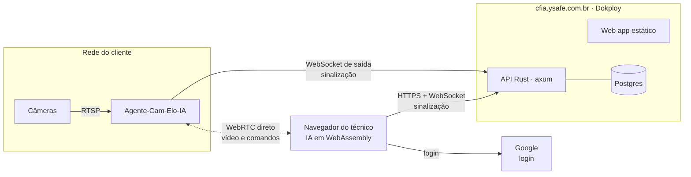

# SDD-08 — Contas de técnico, pareamento e isolamento (web)

Status: proposto · Fase 6 · Domínio: **https://cfia.ysafe.com.br**

## Objetivo
Vários técnicos usam o web app no mesmo domínio, e cada um só enxerga e controla os próprios Agentes-Cam-Elo-IA. O servidor do projeto **nunca recebe vídeo, senha de câmera nem endereço RTSP**.

## Princípios
1. O servidor guarda só **quem é o técnico** e **quais agentes são dele**.
2. Vídeo e comandos vão **direto** entre a rede do cliente e o navegador do técnico (WebRTC). O servidor só apresenta um ao outro (sinalização).
3. O agente só obedece a navegadores que ele mesmo autorizou no pareamento. **Nem o servidor consegue se passar pelo técnico.**
4. Toda consulta da API filtra pelo técnico da sessão.

## Por que WebRTC
Um site HTTPS não pode chamar `http://192.168.x.x` (conteúdo misto e as proteções de acesso à rede local dos navegadores). Com WebRTC:
- na rede local, a conexão é direta entre o navegador e o agente;
- fora dela, funciona pela rede Tailscale do técnico (SDD-01, ADR-0005);
- não há servidor TURN na v1, porque ele faria o vídeo passar pelo servidor do projeto. Sem Tailscale e fora da rede local, o acesso remoto não é suportado na v1.

## Arquitetura

- O agente abre um **WebSocket de saída** para `wss://cfia.ysafe.com.br/ws/agente`. Nenhuma porta é aberta no roteador do cliente.
- O navegador abre `wss://cfia.ysafe.com.br/ws/painel`. A API repassa as mensagens de sinalização (SDP e candidatos ICE) só entre um técnico e os agentes **dele**.

## Login (só Google)
- OpenID Connect com o Google, fluxo *authorization code* com PKCE, feito no servidor.
- Escopos: `openid email profile`. Identidade = `sub` do Google (o e-mail pode mudar).
- O `id_token` é validado: assinatura (JWKS do Google), `iss`, `aud`, `exp` e `nonce`.
- Sessão em cookie `__Host-cfia_sessao`: `HttpOnly`, `Secure`, `SameSite=Lax`, `Path=/`, válido por 30 dias com renovação. No banco fica só o hash do token.
- Pedidos que mudam algo exigem cabeçalho `Origin` igual a `https://cfia.ysafe.com.br`.
- Nenhuma senha é guardada.

### Configuração no Google Cloud
| Item | Valor |
|---|---|
| Tipo de cliente | Aplicativo da Web |
| Origem JavaScript autorizada | `https://cfia.ysafe.com.br` |
| URI de redirecionamento | `https://cfia.ysafe.com.br/api/auth/google/callback` |
| Tela de consentimento | Nome "CamFácil IA", escopos `openid email profile`, links de privacidade e termos no domínio |
| Publicação | Sair do modo "teste" antes de abrir para técnicos (no modo teste, só usuários cadastrados como testadores entram) |

## Chave do navegador
No primeiro acesso, o navegador do técnico gera um par de chaves **ECDSA P-256 não exportável** (WebCrypto) e guarda no IndexedDB. A chave pública é registrada na conta como um **dispositivo**. Um técnico pode ter vários dispositivos e revogar qualquer um.

## Pareamento (QR code)
1. Na instalação, o agente gera o próprio par de chaves Ed25519 e se registra na API com a chave pública.
2. A dashboard local do agente mostra um **QR code** com `https://cfia.ysafe.com.br/parear#c=<código>&f=<impressão digital do agente>`.
   - Código aleatório de 128 bits, **uso único**, válido por **10 minutos**. No banco fica só o hash.
3. O técnico, logado, lê o QR. O navegador envia o código e a chave pública do dispositivo.
4. A API confere o código e o prazo, e grava o **dono provisório**.
5. O agente mostra na tela local: "Parear com **fulano@gmail.com**?", com os botões **Confirmar** e **Recusar**. Só com a confirmação local:
   - o dono é gravado;
   - o agente adiciona a chave do dispositivo à sua **lista local de dispositivos autorizados**.
6. Tentativas são limitadas por IP e por código (ex.: 5 por minuto), e todo pareamento vai para o registro de auditoria.

**Troca de dono:** só por novo pareamento feito no local, depois de "Desparear" na dashboard local do agente. A API não transfere agentes entre contas.

**Novo dispositivo do mesmo técnico:** autorizado a partir de um dispositivo já autorizado (a assinatura dele vai junto) ou por novo QR no local.

## Abertura de sessão com o agente
1. O navegador pede à API uma sessão com o agente X. A API confere `agentes.dono_id = técnico da sessão`. Se não for o dono, a resposta é **404**, e não 403, para não revelar que o agente existe.
2. A troca de SDP passa pela API.
3. Aberto o canal de dados, o agente envia um desafio aleatório. O navegador assina com a chave do dispositivo três coisas: o desafio, a impressão digital DTLS do agente e a sua própria, ambas vindas do SDP.
4. O agente confere a assinatura na **lista local**. Se a chave não estiver lá, ou se as impressões não baterem (tentativa de intermediário), ele fecha a conexão.
5. Só depois o agente aceita comandos e envia vídeo.

Resultado: mesmo um servidor comprometido não consegue comandar câmeras nem ver vídeo.

## Banco de dados (Postgres)
| Tabela | Colunas principais |
|---|---|
| `tecnicos` | `id`, `google_sub` (único), `email`, `nome`, `criado_em` |
| `dispositivos` | `id`, `tecnico_id`, `chave_publica`, `apelido`, `criado_em`, `revogado_em` |
| `agentes` | `id`, `chave_publica` (única), `dono_id`, `apelido_cliente`, `pareado_em`, `ultimo_contato`, `versao` |
| `pareamentos` | `codigo_hash`, `agente_id`, `tecnico_id` (provisório), `expira_em`, `usado_em` |
| `sessoes` | `token_hash`, `tecnico_id`, `expira_em`, `criado_em`, `ip`, `agente_usuario` |
| `auditoria` | `id`, `tecnico_id`, `tipo` (login, pareamento, sessão, revogação), `alvo`, `ip`, `quando` |

O `apelido_cliente` é um texto livre e curto, que o técnico escolhe (ex.: "Bar do centro"). A orientação é não colocar nome de pessoa.

## Isolamento (defesa em camadas)
1. **Aplicação:** todo handler recebe o `tecnico_id` da sessão, e toda consulta usa `WHERE dono_id = $1` ou `tecnico_id = $1`. Não existe rota que receba o ID do técnico como parâmetro.
2. **Banco:** Row-Level Security no Postgres. Cada transação faz `SET LOCAL app.tecnico_id`, e as políticas restringem `agentes`, `dispositivos`, `sessoes` e `auditoria` a esse valor.
3. **Agente:** lista local de dispositivos autorizados (acima).
4. **Rede:** cada técnico usa a própria rede Tailscale.
5. **Testes obrigatórios:** criar dois técnicos e verificar que A não lista, não abre sessão, não pareia e não revoga nada de B. Esses testes rodam no CI.

## API (rascunho)
| Método | Rota | Uso |
|---|---|---|
| GET | `/api/auth/google` | inicia o login |
| GET | `/api/auth/google/callback` | retorno do Google, cria sessão |
| POST | `/api/auth/sair` | encerra a sessão |
| GET | `/api/eu` | dados do técnico logado |
| GET/POST/DELETE | `/api/dispositivos` | lista, registra e revoga dispositivos |
| GET | `/api/agentes` | agentes do técnico, com status on-line |
| PATCH | `/api/agentes/:id` | muda o apelido do cliente |
| POST | `/api/parear` | envia código do QR + chave do dispositivo |
| WS | `/ws/painel` | sinalização do navegador |
| WS | `/ws/agente` | sinalização do agente (autenticado por assinatura Ed25519 a cada conexão) |

## Hospedagem (Dokploy)
| Serviço | Detalhe |
|---|---|
| `cfia-api` | Binário Rust único servindo web app, API e WebSockets; imagem mínima (distroless ou scratch) |
| `cfia-db` | Postgres do Dokploy, com backup diário |
| Domínio | `cfia.ysafe.com.br` com HTTPS automático (Let's Encrypt via Traefik do Dokploy) |
| Segredos | `GOOGLE_CLIENT_ID`, `GOOGLE_CLIENT_SECRET`, `DATABASE_URL`, `SESSAO_CHAVE` em variáveis do Dokploy, nunca no repositório |
| Extra | O mesmo domínio pode servir `install.sh`, `install.ps1` e as releases |

Cabeçalhos: `Strict-Transport-Security`, `Content-Security-Policy` (scripts só do próprio domínio, `wasm-unsafe-eval` para o WebAssembly), `Referrer-Policy: no-referrer`, `X-Content-Type-Options: nosniff`.

## LGPD
- O servidor trata só dados de conta do técnico (e-mail, nome, sub do Google) e metadados técnicos (IPs de acesso, auditoria). Para esses dados, **o projeto é o controlador**. Por isso, no domínio, precisam estar publicados uma política de privacidade e os termos de uso, que vão linkados na tela de consentimento do Google.
- Imagens, câmeras e dados dos clientes finais **não chegam ao servidor** e seguem sob responsabilidade do técnico ([isenção](../legal/ISENCAO.md)).
- Retenção: auditoria por 12 meses; conta excluída a pedido, apagando dispositivos e sessões e desparelhando os agentes.

## Critérios de aceite
- Login com Google funcionando em `https://cfia.ysafe.com.br`.
- Pareamento por QR com confirmação local; código expirado ou reutilizado é recusado.
- Técnico B recebe 404 em qualquer recurso do técnico A (teste automatizado).
- Sessão WebRTC na rede local, com vídeo e comandos, sem tráfego de mídia pelo servidor (verificado pelo consumo de banda do `cfia-api`).
- Agente recusa navegador fora da lista local, mesmo com a sinalização liberada pelo servidor.

## Questões em aberto
- Biblioteca WebRTC no agente: `webrtc-rs` ou `str0m` (avaliar tamanho e consumo; ver orçamento do SDD-01).
- Assinatura dos comandos individuais além da sessão (ex.: abrir portão) ou só a autenticação da sessão.
- Painel de administração para o dono do projeto (só métricas agregadas, sem acesso a agentes).
