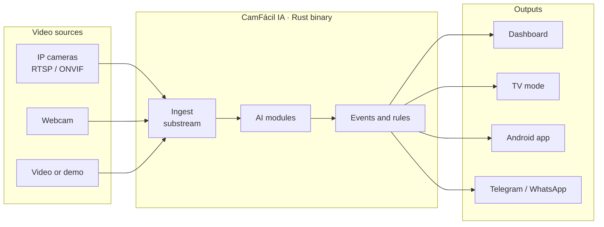

# How it works

Everything runs on the customer's machine, with no mandatory cloud. The AI only analyzes the camera's light stream.

## The tools

| Tool | Runs on | What it does |
|---|---|---|
| **CamFácil IA** | PC, mini PC, Raspberry, TV box | Local server: cameras, AI, alerts, browser dashboard |
| **Agente-Cam-Elo-IA** | Inside the program | Pairs with the dashboard by QR and sends only a summary |
| **Dashboard** | cfia.ysafe.com.br or your server | All your customers, cameras and alerts |
| **Android app** | Phone and TV box | Camera server or remote viewer |
| **Training** | Browser | Short narrated course with exercises and a badge |
| **Studio mode** | Browser + Google Colab | Create and train new models, for study only |

## Principles

- **Lightweight:** idle core under 50 MB of RAM and 2% CPU; binary under 30 MB.
- **No Node, Python or Docker** on the customer's machine. The UI is HTML, CSS and JS embedded in the binary.
- **Offline first:** nothing essential depends on the internet.

Technical details (in Portuguese): [PRD](https://github.com/emersoncassis/CamFacil-IA/blob/main/docs/PRD.md) · [SDDs](https://github.com/emersoncassis/CamFacil-IA/tree/main/docs/sdd) · [ADRs](https://github.com/emersoncassis/CamFacil-IA/tree/main/docs/adr).
