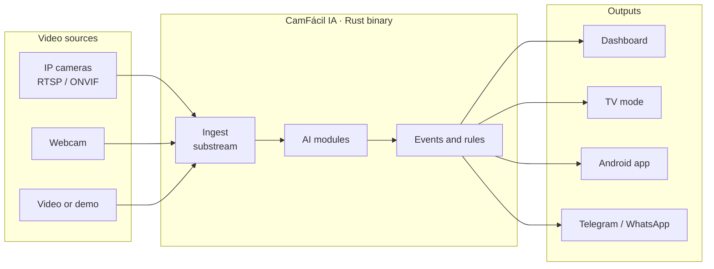
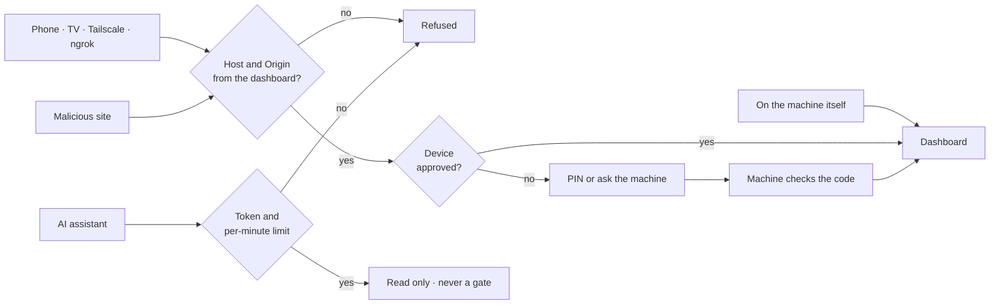

# How it works

Everything runs on the customer's machine, with no mandatory cloud. The AI only analyzes the camera's light stream.

!!! tip "See inside: interactive map"
    The **[interactive map](https://emersoncassis.github.io/CamFacil-IA/mapa-do-codigo/)** shows every part, file and route of CamFácil IA (descriptions in Portuguese), with five guided flows: from camera to alert, live view from anywhere, who can open the dashboard, connected AI on a leash, and from download to the first rule.

## The tools

| Tool | Runs on | What it does |
|---|---|---|
| **CamFácil IA** | PC, mini PC, Raspberry, TV box | Local server: cameras, AI, alerts, browser dashboard |
| **Agente-Cam-Elo-IA** | Inside the program | Pairs with the dashboard by QR and sends only a summary |
| **Dashboard** | cfia.ysafe.com.br or your server | All your customers, cameras and alerts |
| **Android app** | Phone and TV box | Camera server or remote viewer |
| **Training** | Browser | Short narrated course with exercises and a badge |
| **Studio mode** | Browser + Google Colab | Create and train new models, for study only |

## Principles

- **Lightweight:** idle core under 50 MB of RAM and 2% CPU; binary under 30 MB.
- **No Node, Python or Docker** on the customer's machine. The UI is HTML, CSS and JS embedded in the binary.
- **Offline first:** nothing essential depends on the internet.

Technical details (in Portuguese): [PRD](https://github.com/emersoncassis/CamFacil-IA/blob/main/docs/PRD.md) · [SDDs](https://github.com/emersoncassis/CamFacil-IA/tree/main/docs/sdd) · [ADRs](https://github.com/emersoncassis/CamFacil-IA/tree/main/docs/adr).

## Secure by default

On the machine itself everything opens directly. From outside (phone, TV, Tailscale, ngrok), each device is approved once: with the **PIN** generated by the program and shown only on the machine's screen, or **approved on the machine** after checking that both sides show the same code. An AI connected through MCP can read, but cannot abuse it, see secrets or ever open a gate.

Weak PINs (123456, dates, repeats) are refused with an explanation, and wrong attempts lock entry progressively. Everything goes to the log in the **Segurança** (Security) tab. Details in the [security document](https://github.com/emersoncassis/CamFacil-IA/blob/main/docs/seguranca/SEGURANCA.md) (Portuguese).
