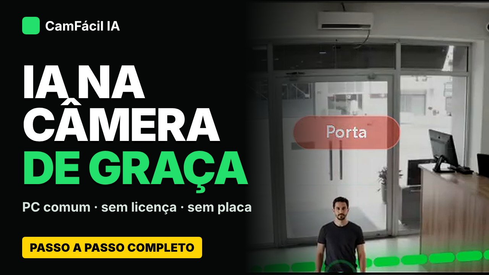

# Video

  Video
  <h2 class="manifesto__title">From download to AI <em>at work.</em></h2>
  
Step by step, uncut: download CamFácil IA, connect a camera, draw a line and a zone and watch the AI work on an ordinary PC, with no license and no graphics card.

  
Premiering soon on YouTube · subtitles in Portuguese, English and Spanish (video narrated in Portuguese)

  

    <a class="md-button md-button--primary" href="../instalacao/">Install with one command</a>
    <a class="md-button md-button--cafe" href="../apoiadores/"><svg class="cafe-ico" viewBox="0 0 16 16" aria-hidden="true"><path d="M2 5h9v4.5A3.5 3.5 0 0 1 7.5 13h-2A3.5 3.5 0 0 1 2 9.5zM11 6h1.2a1.8 1.8 0 0 1 0 3.6H11" fill="none" stroke="currentColor" stroke-width="1.5" stroke-linejoin="round"/><path d="M5 1.5v2M8 1.5v2" stroke="currentColor" stroke-width="1.5" stroke-linecap="round"/></svg>Buy me a coffee</a>
  

What you will see

Download and install on Windows, ONVIF camera, automatic IP fix by MAC, main and sub stream, AI that suggests a rule, line and zone, network and single-line diagram, remote access, LGPD, alerts, training your own model, MCP, backup, report, TV mode and Studio mode.

Chapters

<ul class="video__caps">
<li><strong>0:00</strong> Intro</li>
<li><strong>0:43</strong> Download and open on Windows</li>
<li><strong>3:44</strong> Add a camera</li>
<li><strong>5:52</strong> Line and dwell zone</li>
<li><strong>8:15</strong> Network and single-line diagram</li>
<li><strong>9:56</strong> Remote access (Tailscale, ngrok)</li>
<li><strong>12:53</strong> Alerts: Telegram, WhatsApp, Webhook</li>
<li><strong>13:25</strong> Train your own model</li>
<li><strong>14:44</strong> MCP: operate it with an AI</li>
<li><strong>17:26</strong> TV mode</li>
<li><strong>21:01</strong> AI modules</li>
<li><strong>22:32</strong> Support the project</li>
</ul>

Notice

CamFácil IA is a learning and validation environment, with no warranties. For real use, choose cameras and recorders with edge AI or partner platforms.

