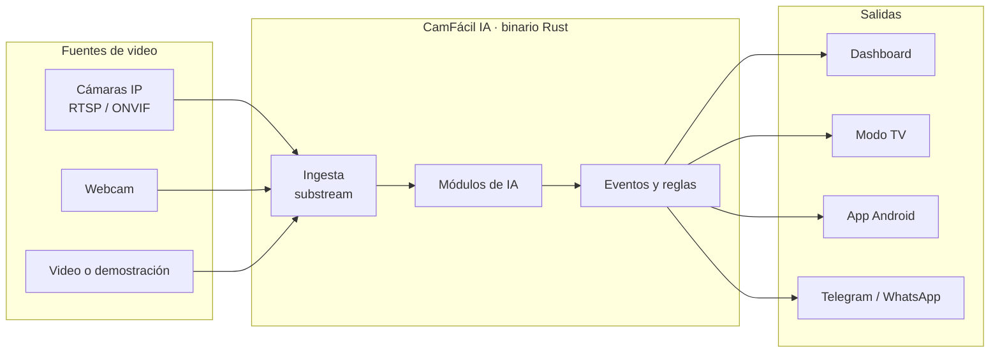
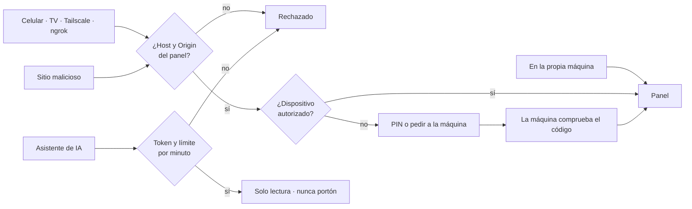

# Cómo funciona

Todo corre en la máquina del cliente, sin nube obligatoria. La IA analiza solo el stream liviano de la cámara.

!!! tip "Mire por dentro: mapa interactivo"
    El **[mapa interactivo](https://emersoncassis.github.io/CamFacil-IA/mapa-do-codigo/)** muestra cada parte, archivo y ruta de CamFácil IA (descripciones en portugués), con cinco flujos guiados: de la cámara a la alerta, ver en vivo desde cualquier lugar, quién puede abrir el panel, IA conectada con rienda y de la descarga a la primera regla.

## Las herramientas

| Herramienta | Dónde corre | Qué hace |
|---|---|---|
| **CamFácil IA** | PC, mini PC, Raspberry, TV box | Servidor local: cámaras, IA, alertas, dashboard en el navegador |
| **Agente-Cam-Elo-IA** | Dentro del programa | Se empareja con el panel por QR y envía solo el resumen |
| **Panel** | cfia.ysafe.com.br o tu servidor | Todos tus clientes, cámaras y alertas |
| **App Android** | Celular y TV box | Servidor de cámaras o visor a distancia |
| **Formación** | Navegador | Curso corto narrado, con ejercicios y sello |
| **Modo estudio** | Navegador + Google Colab | Crear y entrenar inteligencias nuevas, solo para estudio |

## Principios

- **Liviano:** núcleo en reposo por debajo de 50 MB de RAM y 2% de CPU; binario por debajo de 30 MB.
- **Sin Node, Python ni Docker** en la máquina del cliente. La interfaz es HTML, CSS y JS embebidos en el binario.
- **Offline primero:** nada esencial depende de internet.

Detalles técnicos (en portugués): [PRD](https://github.com/emersoncassis/CamFacil-IA/blob/main/docs/PRD.md) · [SDDs](https://github.com/emersoncassis/CamFacil-IA/tree/main/docs/sdd) · [ADRs](https://github.com/emersoncassis/CamFacil-IA/tree/main/docs/adr).

## Seguro por defecto

En la propia máquina todo abre directo. Desde afuera (celular, TV, Tailscale, ngrok), cada dispositivo se autoriza una vez: con el **PIN** generado por el programa, que aparece solo en la pantalla de la máquina, o **autorizado en la máquina**, comprobando el mismo código en los dos lados. La IA conectada por MCP lee, pero no abusa, no ve secretos y nunca acciona un portón.

Un PIN débil (123456, fechas, repeticiones) se rechaza con explicación, y los errores bloquean la entrada de forma progresiva. Todo queda en el registro de la pestaña **Segurança** (Seguridad). Detalles en el [documento de seguridad](https://github.com/emersoncassis/CamFacil-IA/blob/main/docs/seguranca/SEGURANCA.md) (en portugués).
