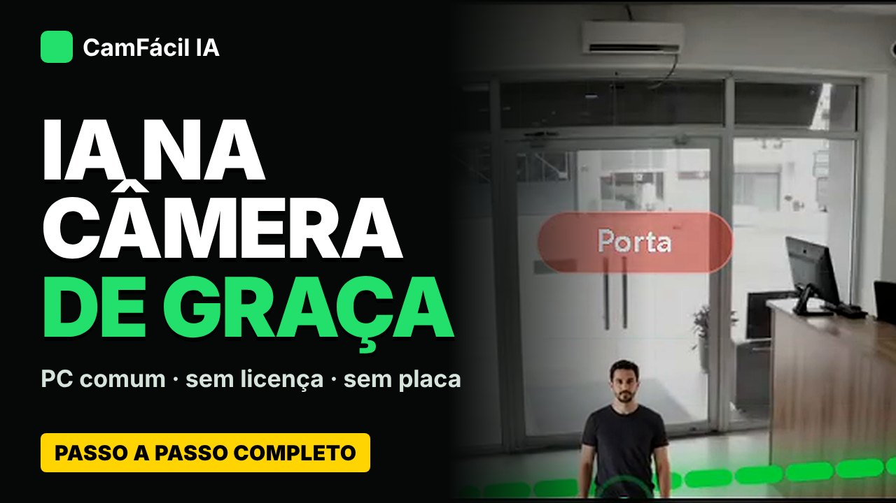

# Video

  Video
  <h2 class="manifesto__title">De la descarga a la IA <em>funcionando.</em></h2>
  
Paso a paso, sin cortes: descargar CamFácil IA, conectar la cámara, crear línea y zona y ver la IA trabajando en un PC común, sin licencia y sin tarjeta de video.

  
Estreno pronto en YouTube · subtítulos en portugués, inglés y español (video narrado en portugués)

  

    <a class="md-button md-button--primary" href="../instalacao/">Instalar con un comando</a>
    <a class="md-button md-button--cafe" href="../apoiadores/"><svg class="cafe-ico" viewBox="0 0 16 16" aria-hidden="true"><path d="M2 5h9v4.5A3.5 3.5 0 0 1 7.5 13h-2A3.5 3.5 0 0 1 2 9.5zM11 6h1.2a1.8 1.8 0 0 1 0 3.6H11" fill="none" stroke="currentColor" stroke-width="1.5" stroke-linejoin="round"/><path d="M5 1.5v2M8 1.5v2" stroke="currentColor" stroke-width="1.5" stroke-linecap="round"/></svg>Apoyar con un café</a>
  

Qué verás en el video

Descarga e instalación en Windows, cámara ONVIF, corrección automática de IP por MAC, stream principal y extra, IA que sugiere una regla, línea y zona, red y diagrama unifilar, acceso desde fuera, LGPD, alertas, entrenamiento de tu modelo, MCP, backup, informe, Modo TV y Modo Estudio.

Capítulos

<ul class="video__caps">
<li><strong>0:00</strong> Apertura</li>
<li><strong>0:43</strong> Descargar y abrir en Windows</li>
<li><strong>3:44</strong> Añadir una cámara</li>
<li><strong>5:52</strong> Línea y zona de permanencia</li>
<li><strong>8:15</strong> Red y diagrama unifilar</li>
<li><strong>9:56</strong> Acceso desde fuera (Tailscale, ngrok)</li>
<li><strong>12:53</strong> Alertas: Telegram, WhatsApp, Webhook</li>
<li><strong>13:25</strong> Entrenar tu propio modelo</li>
<li><strong>14:44</strong> MCP: operar con una IA</li>
<li><strong>17:26</strong> Modo TV</li>
<li><strong>21:01</strong> Módulos de IA</li>
<li><strong>22:32</strong> Apoya el proyecto</li>
</ul>

Aviso

CamFácil IA es un entorno de aprendizaje y validación, sin garantías. Para uso real, usa cámaras y grabadores con IA de borde o plataformas aliadas.

