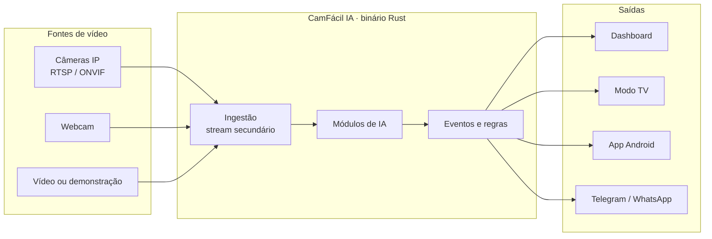

# Como funciona

Tudo roda na máquina do cliente, sem nuvem obrigatória. A IA analisa só o stream leve da câmera.

## As ferramentas

| Ferramenta | Onde roda | O que faz |
|---|---|---|
| **CamFácil IA** | PC, mini PC, Raspberry, TV Box | Servidor local: câmeras, IA, alertas, dashboard no navegador |
| **Agente-Cam-Elo-IA** | Dentro do programa | Pareia com o painel por QR e manda só o resumo |
| **Painel** | cfia.ysafe.com.br ou o seu servidor | Todos os seus clientes, câmeras e alertas |
| **App Android** | Celular e TV Box | Servidor das câmeras ou visualizador à distância |
| **Formação** | Navegador | Curso curto com narração, exercícios e selo |
| **Modo estúdio** | Navegador + Google Colab | Criar e treinar inteligências novas, só para estudo |

## Princípios

- **Leve:** núcleo ocioso abaixo de 50 MB de RAM e 2% de CPU; binário abaixo de 30 MB.
- **Sem Node, Python ou Docker** na máquina do cliente. A interface é HTML, CSS e JS embutidos no binário.
- **Offline primeiro:** nada essencial depende de internet.

Detalhes técnicos: [PRD](https://github.com/emersoncassis/CamFacil-IA/blob/main/docs/PRD.md) · [SDDs](https://github.com/emersoncassis/CamFacil-IA/tree/main/docs/sdd) · [ADRs](https://github.com/emersoncassis/CamFacil-IA/tree/main/docs/adr).
