# CamFácil IA Builder

<div class="builder" markdown>
<div class="builder__arte">
  
</div>
<div class="builder__texto" markdown>
<span class="manifesto__kicker">O mestre de obras do projeto</span>

<p class="builder__titulo">Você diz o que quer. <em>Ele constrói.</em></p>

O Builder é uma skill para assistentes de código (Claude Code, Codex e outros). Você conversa em português, do jeito que fala com um colega de instalação, e ele muda telas, cria funções e inteligências na **sua versão** do CamFácil IA. Sem você escrever uma linha de código.

[:fontawesome-brands-github: Fazer o fork](https://github.com/emersoncassis/CamFacil-IA/fork){ .md-button .md-button--primary }
[Ver a skill](https://github.com/emersoncassis/CamFacil-IA/blob/main/.claude/skills/camfacil-ia-builder/SKILL.md){ .md-button }
</div>
</div>

## Comece em três passos

1. **Faça o fork** do repositório no GitHub e baixe a sua cópia:

    ```sh
    git clone https://github.com/SEU-USUARIO/CamFacil-IA && cd CamFacil-IA
    ```

2. **Abra a pasta no seu assistente de código.** No Claude Code, basta rodar `claude` dentro dela. Outros assistentes leem o arquivo `AGENTS.md`, que aponta para o Builder.

3. **Chame o Builder** e diga o que você quer:

    ```text
    /camfacil-ia-builder quero um aviso quando alguém ficar mais de 2 minutos parado na frente do portão
    ```

Ele confere as ferramentas do seu computador, instala o que faltar, abre o programa original para você ver o "antes" e só então começa.

## O que você pode pedir

??? example "Mudar a cara do programa"
    Trocar nome, logo, cores e textos pelos da sua empresa, reorganizar telas, criar um modo para a TV do cliente. As cores saem de um arquivo só, então a troca vale para o programa inteiro.

??? example "Criar uma inteligência nova"
    Um tipo novo de alerta sobre pessoas e veículos (linha, zona, permanência, contagem), ou um modelo treinado por você no modo estúdio.

??? example "Ligar a outros sistemas"
    Uma marca nova de câmera ou gravador, um aviso em outro canal, um webhook para a automação do cliente.

??? example "Relatórios e manutenção"
    Um relatório com a sua marca, um diagnóstico de rede a mais, uma tela de saúde das câmeras do jeito que você explica para o cliente.

## O que ele não faz, e por quê

O Builder recusa o pedido que fere a lei, a licença ou a segurança. Ele diz **qual regra** e oferece **o que dá para fazer no lugar**.

| Você pede | Ele responde |
|---|---|
| Reconhecer quem é a pessoa pelo rosto | Não. Biometria é dado sensível (LGPD, art. 11). No lugar: detectar presença, permanência e cruzamento de linha, sem identificar ninguém. |
| Tirar a placa de aviso ou os termos | Não. A LGPD exige transparência com quem é filmado. Ele personaliza o texto com a sua marca, mas não remove. |
| Acessar câmera que não é do cliente | Não. Invasão de dispositivo é crime (Código Penal, art. 154-A). |
| Fechar o código da sua versão | Não. A licença AGPL-3.0 exige o código aberto, inclusive para quem usa pela rede. |
| Tirar o PIN do acesso pela rede | Não. Uma brecha na sua versão é uma porta aberta na loja do cliente. |
| Painel multicliente, gravação contínua | Fica fora do projeto oficial. Na sua versão ele faz, depois de avisar o que muda nas suas responsabilidades. |

Lista completa: [limites do Builder](https://github.com/emersoncassis/CamFacil-IA/blob/main/.claude/skills/camfacil-ia-builder/referencias/limites.md). É orientação técnica, não consultoria jurídica.

## Como ele trabalha

O Builder segue o método do **Reversa**: primeiro o combinado, depois o código.

1. **Entende** o pedido e repete com as palavras dele, para você confirmar.
2. **Confere** contra a lei, a licença, a segurança e as regras do projeto.
3. **Especifica** a função e mostra o plano em poucas linhas. Só segue com o seu "pode ir".
4. **Constrói** em passos pequenos, numa cópia de teste. O original nunca se perde.
5. **Prova**: roda os testes, abre o programa e mostra funcionando.
6. **Documenta** o que mudou, para a próxima pessoa (ou a próxima IA) continuar.

## A sua versão, as suas obrigações

- **Continua livre.** A sua versão segue AGPL-3.0, com o código aberto e os créditos preservados.
- **Diga que é uma versão modificada**, com o seu nome e a data. A marca que aparece para o cliente é a sua, nunca a de um fabricante.
- **A LGPD é com você.** Use os [modelos de termo, autorização e placa](privacidade.md).
- **Melhorou algo que serve para todo mundo?** Mande de volta: veja [Contribuir](contribuindo.md).

<footer class="builder__creditos" markdown>
**Créditos.** O CamFácil IA Builder é construído sobre o [Reversa](https://github.com/sandeco/reversa), framework de engenharia reversa de especificações criado pelo professor **Sandeco Macedo** ([@sandeco](https://github.com/sandeco)), sob licença MIT. Todo o método de desenvolvimento do Builder vem dele. [Documentação do Reversa](https://sandeco.github.io/reversa/pt/) · [Artigo](https://arxiv.org/abs/2605.18684)
</footer>
