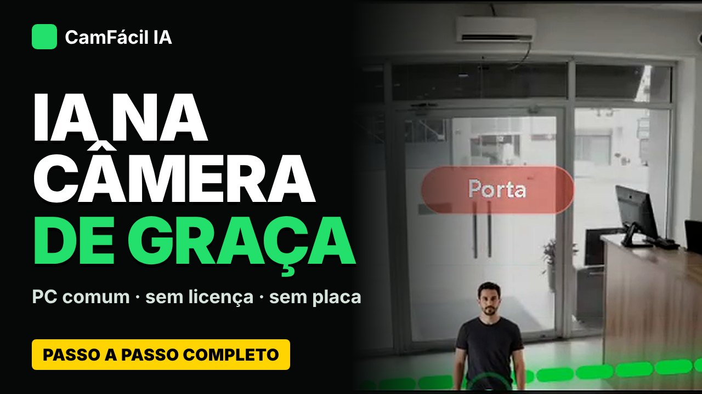

# Vídeo

  Vídeo
  <h2 class="manifesto__title">Do download à IA <em>funcionando.</em></h2>
  
Passo a passo, sem corte: baixar o CamFácil IA, ligar a câmera, criar linha e zona e ver a IA trabalhando num PC comum, sem licença e sem placa de vídeo.

  
Estreia em breve no YouTube · legendas em português, inglês e espanhol

  

    <a class="md-button md-button--primary" href="../instalacao/">Instalar em um comando</a>
    <a class="md-button md-button--cafe" href="../apoiadores/"><svg class="cafe-ico" viewBox="0 0 16 16" aria-hidden="true"><path d="M2 5h9v4.5A3.5 3.5 0 0 1 7.5 13h-2A3.5 3.5 0 0 1 2 9.5zM11 6h1.2a1.8 1.8 0 0 1 0 3.6H11" fill="none" stroke="currentColor" stroke-width="1.5" stroke-linejoin="round"/><path d="M5 1.5v2M8 1.5v2" stroke="currentColor" stroke-width="1.5" stroke-linecap="round"/></svg>Apoiar com um café</a>
  

O que você vê no vídeo

Download e instalação no Windows, câmera ONVIF, correção automática de IP pelo MAC, stream principal e extra, IA que sugere regra, linha e zona, rede e diagrama unifilar, acesso de fora, LGPD, alertas, treino do seu modelo, MCP, backup, relatório, Modo TV e Modo Estúdio.

Capítulos

<ul class="video__caps">
<li><strong>0:00</strong> Abertura</li>
<li><strong>0:43</strong> Baixar e abrir no Windows</li>
<li><strong>3:44</strong> Adicionar uma câmera</li>
<li><strong>5:52</strong> Linha e zona de permanência</li>
<li><strong>8:15</strong> Rede e diagrama unifilar</li>
<li><strong>9:56</strong> Acesso de fora (Tailscale, ngrok)</li>
<li><strong>12:53</strong> Alertas: Telegram, WhatsApp, Webhook</li>
<li><strong>13:25</strong> Treinar seu próprio modelo</li>
<li><strong>14:44</strong> MCP: operar com uma IA</li>
<li><strong>17:26</strong> Modo TV</li>
<li><strong>21:01</strong> Módulos de IA</li>
<li><strong>22:32</strong> Apoie o projeto</li>
</ul>

Aviso

O CamFácil IA é um ambiente de aprendizado e validação, sem garantias. Para uso real, use câmeras e gravadores com IA de borda ou plataformas parceiras.

